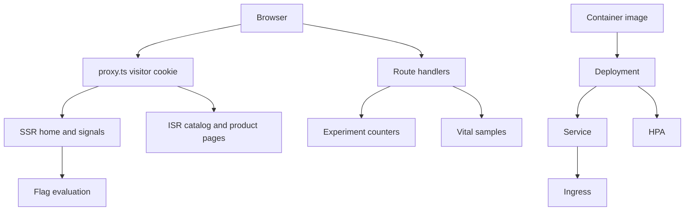

# Northline

A small storefront that shows how a Next.js app can stay fast, accessible, and shippable. It is a portfolio demo: six products, no checkout, and enough of the production path to run tests and a local Kubernetes cluster.

## Architecture



The home page is server-rendered because the hero depends on the visitor. Catalog and product pages are statically generated and revalidated every 60 seconds. Field notes and the vitals reporter are separate client chunks. Product art is encoded to WebP at build time and served directly, so the LCP image does not wait on a runtime transcoder. The hero is the LCP candidate: `fetchpriority="high"`, explicit dimensions, and no lazy load. Cards below the fold keep the default lazy loading. Off-screen workshop cards and field notes use `content-visibility: auto` with `contain-intrinsic-size`.

Metrics stay in process memory. With more than one pod they are not shared. That is intentional for the demo; a shared store would be the production swap.

## What is included

- Core Web Vitals: code splitting, lazy loading, image optimization, SSR, and ISR
- `POST /api/vitals` and `GET /api/vitals` for LCP, INP, CLS, FCP, and TTFB, with server-side rating and p75
- Semantic landmarks, a skip link, a native cart `<dialog>`, and Playwright checks with axe
- A flag evaluator in the shape of OpenFeature evaluation details, plus a 50/50 hero headline experiment
- Jest unit tests, Playwright end-to-end tests, and a Lighthouse CI budget
- Dockerfile, Kubernetes Deployment, Service, Ingress, and HPA, and a kind guide
- GitHub Actions workflow that runs unit tests, Playwright, and Lighthouse

## Run it locally

Requires Node.js 22.

```bash
npm ci
npm run dev
```

Open [http://localhost:3000](http://localhost:3000).

| Path | What it shows |
| --- | --- |
| `/` | SSR hero experiment |
| `/catalog` and `/catalog/camp` | ISR catalog |
| `/products/field-jacket` | ISR product, lazy field notes, add to pack |
| `/signals` | Variant assignment, experiment counts, vitals p75 |
| `/api/health` | Probe used by Kubernetes |
| `/api/flags?visitor=abc` | Flag evaluation for a visitor id |
| `/api/experiments` | Exposure and conversion counts |
| `/api/vitals` | Recent samples and p75 |

`FLAG_SHOW_FIELD_NOTES=false` turns field notes off. Any other value, including unset, leaves them on.

The hero experiment key is `hero-headline`. Assignment hashes `hero-headline:<visitor id>` so the same cookie always gets the same variant. Adding an item to the pack counts as a conversion.

## Tests

```bash
npm test
npm run build
npm run test:e2e
npm run lhci
```

Playwright and Lighthouse CI start the production server on port 3000, so build first and stop any other server on that port. Lighthouse budgets in `lighthouserc.cjs` fail the run below 0.90 performance, 0.95 accessibility, 0.90 best practices, and 0.90 SEO. LCP must stay under 3.5s and CLS under 0.1.

## Docker

```bash
docker build -t northline:local .
docker run --rm -p 3000:3000 northline:local
```

The image uses Next.js standalone output. The container listens on `0.0.0.0:3000` and probes `/api/health`.

## Kubernetes with kind

Install [kind](https://kind.sigs.k8s.io/), kubectl, and an ingress-nginx build that supports kind.

```bash
kind create cluster --config k8s/kind-config.yaml
docker build -t northline:local .
kind load docker-image northline:local --name northline
kubectl apply -f https://raw.githubusercontent.com/kubernetes/ingress-nginx/main/deploy/static/provider/kind/deploy.yaml
kubectl wait --namespace ingress-nginx \
  --for=condition=ready pod \
  --selector=app.kubernetes.io/component=controller \
  --timeout=180s
kubectl apply -k k8s
```

The kind node maps container port 80 to host port 8080. Add `127.0.0.1 northline.local` to `/etc/hosts`, then open [http://northline.local:8080](http://northline.local:8080). The ingress also accepts requests with no host, so [http://127.0.0.1:8080](http://127.0.0.1:8080) works too.

The HorizontalPodAutoscaler targets 70% CPU, with a floor of 2 pods and a ceiling of 6. kind does not ship metrics-server. Install it before expecting the HPA to scale:

```bash
kubectl apply -f https://github.com/kubernetes-sigs/metrics-server/releases/latest/download/components.yaml
kubectl patch deployment metrics-server -n kube-system --type=json \
  -p='[{"op":"add","path":"/spec/template/spec/containers/0/args/-","value":"--kubelet-insecure-tls"}]'
```

`FLAG_SHOW_FIELD_NOTES` is set on the Deployment. Change it and roll the pods to hide field notes.

Tear the cluster down with `kind delete cluster --name northline`.

## Project layout

```
src/app          routes, route handlers, global styles
src/components   header, catalog, cart dialog, vitals reporter
src/lib          products, flags, experiment counters, vitals
src/proxy.ts     visitor id cookie and request header
e2e              Playwright and axe
k8s              kind config and manifests
```
